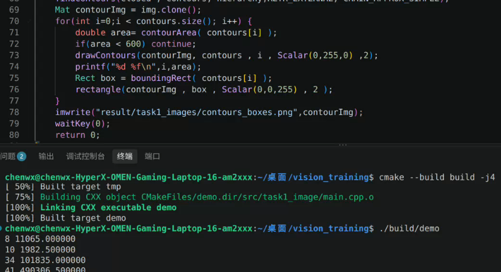

# vision_training 
## 环境
- Ubuntu 22.04 LTS
- CMake 3.22+
- GCC 11+
## 目录结构
### resources
用于存放素材文件,作为输入路径
### src
用于存放源代码，其中每个文件夹的 `main.cpp` 为有效代码。
### build
用于构建编译器参数并生成可执行文件
### result
用于存放项目结果，作为输出路径

## 构建和运行
```bash
cmake -S . -B build
cmake --build build -j4
./build/demo
```
## 关键参数以及说明分析
### task1_image
- `blur,GaussianBlur,medianBlur` 的 `kernel` 取 `5`，其中 `GaussianBlur` 的标准差取 `1.5`；
- 均值滤波下，花瓣边缘整体变模糊，细节纹理被抹平。边缘处两侧像素混合，导致边缘对比度下降。
- 高斯滤波下，边缘模糊程度比均值滤波温和，细节保留稍好，但纹理仍有损失。
- 中值滤波下，边缘保留最好，花瓣轮廓清晰，细节纹理基本保留。
- 红色在掩膜中呈现完整的白色区域；黄色由于 `H` 值与红色存在较大差异，被很好的去除，显示黑色。
- 部分阴影因为 `S,V` 与深红色相近，存在一定的误提取，但整体提取效果好。
- 生成红色掩膜 `inRange` 参数：`H` 取 `[0,10],[170,179]`，`S` 取 `[110,255]`，`V` 取 `[60,255]`；
- 腐蚀，膨胀，开闭运算的 `kernel` 取 `7`，提取外轮廓时选用的模板为对于红色掩膜闭运算后的图片
- 矩形面积阈值为 `600`，最终共4个矩形，轮廓面积分别为：